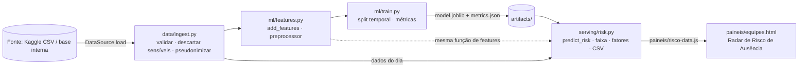

# Arquitetura de referência e SOLID

## Princípios SOLID aplicados

| Princípio | Onde | Problema resolvido |
|---|---|---|
| S · SRP | data / ml / serving | Módulos separados por responsabilidade: aquisição e proteção de dados, engenharia/treino e inferência/saídas. |
| O · OCP | ml/train.py (`MODEL_REGISTRY`) | Novos algoritmos entram com `register_model()`, sem editar `train_model()`. Testado com um DummyClassifier. |
| L · LSP | data/ingest.py (`CsvSource`, `SyntheticSource`) | Qualquer `DataSource` devolve o mesmo esquema e pode substituir outra; o teste usa uma fonte em memória. |
| I · ISP | serving/risk.py (`Predictor`) | Serving exige só `predict_proba()`; não conhece treino nem a classe do modelo. |
| D · DIP | ml/train.py ← `DataSource` | `train_model(source: DataSource)` não sabe se os dados vêm de CSV, Kaggle ou banco; trocar a fonte não altera o treino. |

## Do backlog aos módulos

| Story | Módulo |
|---|---|
| US1 | ml/train.py, serving/risk.py |
| US2 | ml/features.py, ml/train.py |
| US3 | data/ingest.py |
| US4 | data/ingest.py |
| US5 | serving/risk.py |
| US6 | serving/risk.py |
| US7 | src/monitoring/ (futuro) |
| US8 | serving/risk.py, src/monitoring/ (futuro) |
| US9 | src/monitoring/ (futuro) |
| US10 | serving/risk.py |

## Pontos de atenção
- `ml/features.py` é a única definição de atributos (sem duplicar lógica entre treino e serving).
- Split **temporal**: treina no passado, testa no futuro.
- `src/monitoring/` (US7, US9) ainda não existe — é Onda 2.
- Os módulos antigos na raiz de `src/` são aliases temporários para preservar imports e comandos existentes; código novo deve usar os subpacotes.
