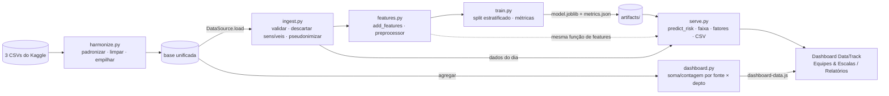

# Arquitetura de referência e SOLID

## Princípios SOLID aplicados

| Princípio | Onde | Problema resolvido |
|---|---|---|
| S · SRP | ingest / features / train / serve | Um script único misturava carga, limpeza, treino e saída; agora cada módulo tem um motivo para mudar e é testável isoladamente. |
| O · OCP | train.py (MODEL_REGISTRY) | Novos algoritmos entram com register_model(), sem editar train_model(). Testado com um DummyClassifier. |
| L · LSP | ingest.py (CsvSource, KaggleHRSource, SyntheticSource) | Qualquer DataSource devolve o mesmo esquema e pode substituir outra; o teste usa uma fonte em memória. |
| I · ISP | serve.py (Predictor) | Serving exige só predict_proba(); não conhece treino nem a classe do modelo. |
| S · SRP | dashboard.py | Agregar para o painel é responsabilidade própria; treino e serving não sabem que o painel existe. |
| D · DIP | train.py ← DataSource | train_model(source: DataSource) não sabe se os dados vêm de CSV, Kaggle ou banco; trocar a fonte não altera o treino. |

## Do backlog aos módulos

| Story | Módulo |
|---|---|
| US1 | train.py, serve.py, dashboard.py |
| US2 | features.py, train.py |
| US3 | ingest.py |
| US4 | ingest.py |
| US5 | serve.py, dashboard.py |
| US6 | serve.py |
| US7 | monitor.py (novo) |
| US8 | serve.py, monitor.py |
| US9 | monitor.py (novo) |
| US10 | serve.py |

## Pontos de atenção
- `features.py` é a única definição de atributos (sem duplicar lógica entre treino e serving).
- Split **estratificado** (as bases não têm data de ausência, logo não há split temporal).
- `harmonize.py` mescla as bases por empilhamento: elas não têm chave em comum.
- `dashboard.py` só agrega e exporta; as regras de status das metas vivem em `PARAMS` (OCP: nova meta = novo item da lista, sem mexer no JS).
- `monitor.py` (US7, US9) ainda não existe — é Onda 2.
